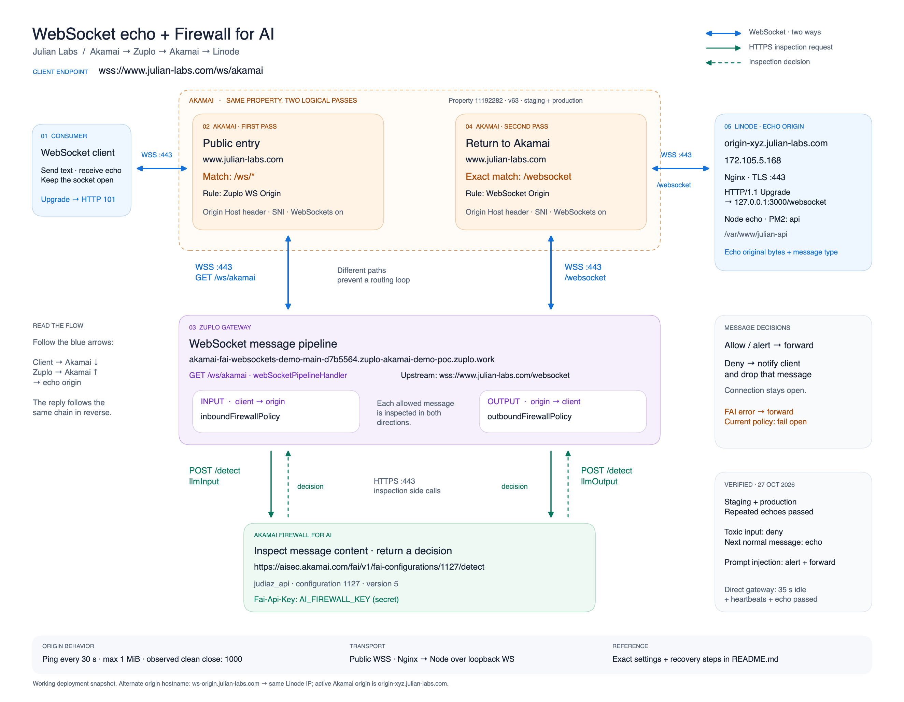

# julian-api

Express API and demo frontend, including a WebSocket echo origin for the Akamai → Zuplo → Akamai flow.

## Protected AJAX testing tool

Open **AJAX (Fetch) Login**, enter the testing passphrase, and choose **Unlock** to load the private controls. The public HTML and JavaScript contain a generic renderer; the header definitions and presets are encrypted in `config/testing-tools.enc.json`. The server decrypts them only after a successful passphrase check. The JSON preview and outgoing request share a header builder. Ordinary login works while the tool is locked.

The passphrase is cleared from the input after an unlock attempt. Decrypted definitions stay in page memory, with **Lock tools** and a 15-minute automatic lock; reload also locks the tool. Neither the passphrase nor definitions are stored in browser storage. Lock clears selections and displayed responses. An authorized user can still inspect and retain headers in browser developer tools: this protects access to the tool, not acceptance of manually crafted requests by Akamai.

### Local preview

```sh
npm run preview
```

Open `http://127.0.0.1:8080`. This starts the frontend and unlock endpoint without MySQL or WebSockets. Login submissions still go to the public API configured in `frontend/script.js`. A plain static file server cannot unlock the tool.

Styles are compiled locally into the committed `frontend/assets/app.css`; the passphrase page does not run the external Tailwind script. After changing frontend classes, run `npm run build:css` (using pinned Tailwind 3.4.1) and include the rebuilt CSS in the deployment.

### Passphrase setup and rotation

The local source schema and generated passphrase are kept in the ignored `.private-testing-tools/` directory, with owner-only permissions. Keep these files private and save the passphrase in your password manager. Never commit them or include them in the static frontend.

To encrypt the local schema with a strong generated passphrase:

```sh
npm run testing-tools:seal -- --generate
```

The command writes the passphrase to `.private-testing-tools/passphrase.txt`, prints only file paths, and updates the encrypted bundle. To choose your own passphrase instead, run `npm run testing-tools:seal` in an interactive terminal; input is hidden and must be confirmed. A long, randomly generated passphrase is recommended because this public repository exposes ciphertext to offline guessing. Re-seal and deploy the updated bundle to rotate the passphrase. Previously published bundles remain in Git history and can still be decrypted with their old passphrases; rotation cannot revoke definitions already disclosed. Keep a private backup of the source schema if you need to edit the presets on another machine.

### Deployment and protection boundary

Deploy the server changes and encrypted bundle together using the existing workflow. No passphrase is placed in the frontend or deployment environment. **The gateway is a separate deployment:** the `jdiax3004/julian-api-gtw` repository also needs a `POST /api/testing-tools/unlock` route. Use its existing URL Forward handler and backend base URL (`https://origin-xyz.julian-labs.com`), preserving the request path and JSON body, with `corsPolicy: none`. A gateway 404 for this POST means it never reached this app; pushing this repository alone cannot register a Zuplo route.

The gateway's API Security plugin must exclude `/api/testing-tools` and its descendants from `shouldLog` before enabling the route. This prevents its body capture from exporting passphrases or decrypted definitions. Keep normal API logging unchanged, omit private request/response examples, and disable caching on this path. Serve the entire request path over HTTPS. At the origin, the unlock router is mounted before public CORS and API example capture, and returns responses with caching disabled.

After deploying both repositories, test routing without a real passphrase:

```sh
curl -i https://www.julian-labs.com/api/testing-tools/unlock \
  -H 'Content-Type: application/json' --data '{}'
```

Expect the origin's `400` JSON response (`Invalid unlock request.`) and `Cache-Control: no-store`. This checks the POST route without attempting decryption. Opening the endpoint in a browser sends GET, which can still return gateway 404 because the route permits only POST.

Failed unlocks reveal no definitions. Request size, attempt rates, and concurrent decryptions are limited. Limits are per Node process; per-peer limits use the actual socket peer, so requests through a proxy may share a bucket. The tool fails closed when the encrypted bundle is missing or invalid. The private directory and `config/` must remain outside any public static directory.

Encryption uses authenticated AES-256-GCM and a salted scrypt key derived from the passphrase. Its fixed scrypt parameters follow an [OWASP-listed configuration](https://cheatsheetseries.owasp.org/cheatsheets/Password_Storage_Cheat_Sheet.html#scrypt); cryptographic operations use [Node's crypto module](https://nodejs.org/api/crypto.html). No plaintext header inventory is included in this README or public scripts.

## WebSocket echo

Connect to `ws://localhost:3000/websocket` locally. It uses the same HTTP server and `PORT` as the rest of the app (`3000` by default).

- Every text or binary message is echoed to the sending connection, preserving its bytes and message type. There is no greeting, prefix, JSON wrapping, or API key requirement.
- A connection accepts repeated messages. The server sends a WebSocket ping every 30 seconds and disconnects peers that fail to return a pong before the next heartbeat. Standard WebSocket clients respond automatically.
- There is no application idle timeout. Proxy timeouts, network failures, restarts, and peer closes can still end a connection. Heartbeats cover the origin connection; Zuplo creates a separate client-facing connection, so test idle behavior through the complete chain too.
- Messages are limited to 1 MiB; larger messages close with WebSocket code `1009`.
- An ordinary HTTP GET to `/websocket` returns `426 Upgrade Required`. A successful WebSocket handshake returns `101 Switching Protocols`.
- The existing `/ws?key=...` OpenAI proxy remains separate. The echo endpoint does not call OpenAI, MySQL, Heroku, or another echo service.

Install and run the existing app with its usual `.env` database settings:

```sh
npm ci --legacy-peer-deps
npm start
```

The full app still runs its existing database initialization on startup. The echo tests run independently of the database:

```sh
npm test
```

## Akamai → Zuplo → Akamai → this app

The working deployment uses the same Akamai property for both passes, with separate paths for the Zuplo gateway and the echo origin. Zuplo sends input and output messages to Firewall for AI over HTTPS before forwarding them.



[Full-size SVG](docs/architecture/websocket-fai-architecture-spaced.svg) · [Editable Excalidraw diagram](docs/architecture/websocket-fai-architecture-spaced.excalidraw) · [Configuration, test results, and recovery notes](docs/architecture/README.md)

Deployment snapshot verified on **27 October 2026**: Akamai property **11192282**, version **63**, active on staging and production. Blue arrows are bidirectional WebSocket connections; solid green arrows are FAI inspection requests and dashed green arrows are their decisions.

```text
Client: wss://www.julian-labs.com/ws/akamai
  → Akamai rule /ws/*: origin = akamai-fai-websockets-demo-main-d7b5564.zuplo-akamai-demo-poc.zuplo.work
  → Zuplo route /ws/akamai: upstream = wss://www.julian-labs.com/websocket
  → Akamai rule /websocket: origin = origin-xyz.julian-labs.com (172.105.5.168)
  → Nginx HTTPS :443 → Node /websocket on 127.0.0.1:3000
```

To recreate or update the deployment:

1. In Akamai's **WebSocket Origin** rule matching `/websocket`, use the direct origin hostname of the Linode hosting this app. The active origin is `origin-xyz.julian-labs.com`, pointing to `172.105.5.168`. The alternate `ws-origin.julian-labs.com` record points to the same IP; it is provisioned but is not the active return-leg origin. The previous `ws-go.nchen.work` origin is retired.
2. Make the origin's HTTPS virtual host accept the chosen hostname and serve a certificate valid for it. With **Forward Host Header = Origin Hostname**, align the forwarded Host, origin TLS SNI, and certificate verification with that hostname. Preserve `/websocket` when forwarding to Node.
3. Enable Akamai's **WebSockets** behavior on both relevant rules. Keep `/ws/*` pointed at Zuplo and `/websocket` pointed at Linode. The direct origin record must not resolve back to Akamai or Zuplo, which would create a routing loop. Akamai's documented 300-second Read Timeout recommendation applies to long-poll fallback, not to an established WebSocket's lifetime.
4. In Zuplo, keep the `/ws/akamai` upstream WebSocket URL set to `wss://www.julian-labs.com/websocket`. The separate `/ws/echo` route still referenced Heroku when inspected; the verified flow uses `/ws/akamai`. Existing message inspection policies can block or transform messages before/after the echo server.
5. Test the origin directly, then `wss://www.julian-labs.com/websocket`, then the complete route `wss://www.julian-labs.com/ws/akamai`. Verify a `101` upgrade, repeated echoes, and an idle connection beyond the configured proxy timeouts.

Only `/ws/akamai` goes through the full inspection chain. `/websocket` is the second-leg entry point. If the deployment uses SiteShield, apply its origin access restrictions to the new Linode origin as well.

The existing GitHub Actions workflow deploys pushes to `main` to `/var/www/julian-api` and reloads the PM2 `api` process. DNS, Akamai, Zuplo, and origin reverse-proxy settings are managed outside this repository.

### Origin Nginx example

If Nginx terminates HTTPS on Linode, add this location inside the appropriate existing TLS `server` block. Use the app's configured port if it differs from `3000`:

```nginx
location = /websocket {
    proxy_pass http://127.0.0.1:3000;
    proxy_http_version 1.1;
    proxy_set_header Upgrade $http_upgrade;
    proxy_set_header Connection "upgrade";
    proxy_set_header Host $host;
    proxy_read_timeout 300s;
    proxy_send_timeout 300s;
    proxy_buffering off;
}
```

### Quick echo check

Run from this repository while the server is running. Change `WS_URL` to test either Akamai leg after deployment:

```sh
WS_URL=ws://localhost:3000/websocket node <<'NODE'
const WebSocket = require('ws');
const socket = new WebSocket(process.env.WS_URL);
socket.on('open', () => socket.send('Hello through WebSockets'));
socket.on('message', (data) => {
  console.log(data.toString()); // Hello through WebSockets
  // The connection remains open; press Ctrl+C to exit this check.
});
socket.on('error', console.error);
socket.on('close', (code) => console.log('Closed:', code));
NODE
```

References: [ws routing and heartbeat examples](https://github.com/websockets/ws), [Akamai WebSockets support](https://techdocs.akamai.com/property-mgr/docs/websockets-support), [Akamai origin settings](https://techdocs.akamai.com/property-mgr/docs/origin-server), [Zuplo WebSocket handler](https://zuplo.com/docs/handlers/websocket-handler), [Nginx WebSocket proxying](https://nginx.org/en/docs/http/websocket.html).
