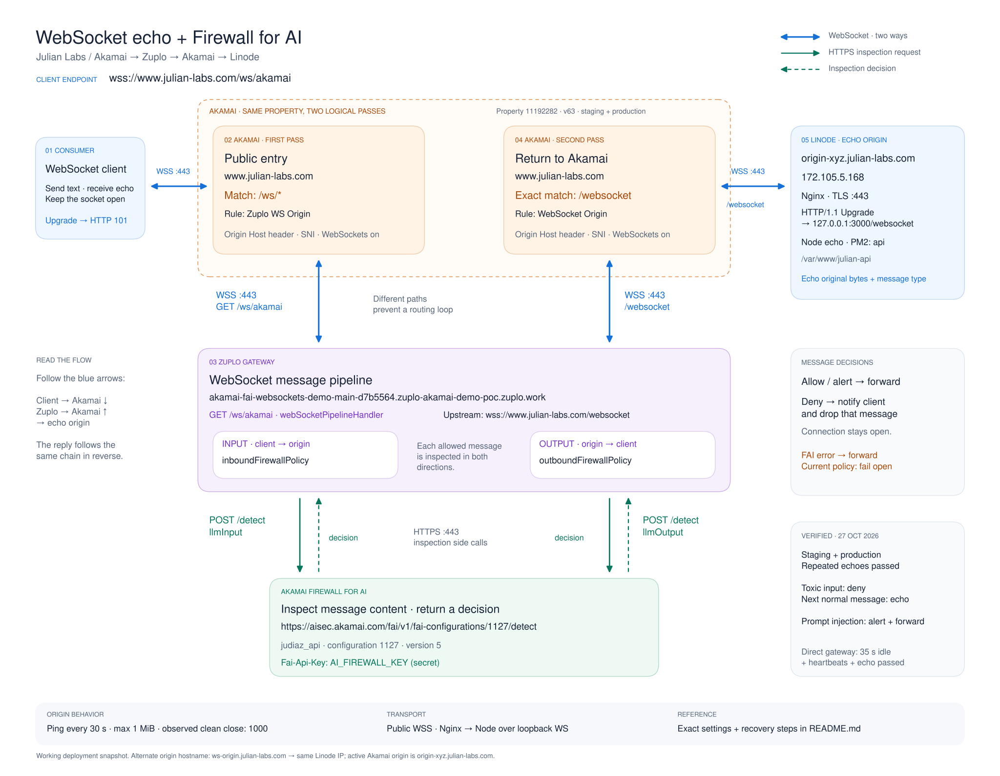

# WebSocket echo with Akamai, Zuplo and Firewall for AI

Working-state snapshot: **27 October 2026**, America/Toronto.

## Diagram files

- [Editable Excalidraw scene](websocket-fai-architecture-spaced.excalidraw): open [Excalidraw](https://excalidraw.com), choose **Open**, and select the file. Shapes, text and arrows are editable; component contents are grouped.
- [SVG](websocket-fai-architecture-spaced.svg): scalable diagram for documents and presentations.
- [PNG](websocket-fai-architecture-spaced.png): image preview and sharing.

The spaced layout separates the Akamai, Zuplo and FAI layers. Blue arrows show bidirectional WebSocket connections. Each inspection lane has a solid green request arrow and a dashed green decision arrow. The original compact layout remains available as [Excalidraw](websocket-fai-architecture.excalidraw), [SVG](websocket-fai-architecture.svg), and [PNG](websocket-fai-architecture.png).

The two Akamai boxes represent two logical passes through the **same property**, not two dedicated physical edge servers. FAI receives separate HTTPS inspection calls from Zuplo; it is not a WebSocket origin or another WebSocket hop.

## Exact endpoints

| Purpose | Address |
| --- | --- |
| Client endpoint through the complete chain | `wss://www.julian-labs.com/ws/akamai` |
| Direct Zuplo gateway test | `wss://akamai-fai-websockets-demo-main-d7b5564.zuplo-akamai-demo-poc.zuplo.work/ws/akamai` |
| Zuplo upstream: second Akamai pass | `wss://www.julian-labs.com/websocket` |
| Active Akamai return-leg origin | `origin-xyz.julian-labs.com` |
| Direct active-origin test | `wss://origin-xyz.julian-labs.com/websocket` |
| Alternate provisioned origin hostname | `wss://ws-origin.julian-labs.com/websocket` |
| Linode address | `172.105.5.168` |
| Nginx upstream on the Linode | `http://127.0.0.1:3000/websocket` with WebSocket upgrade |
| FAI detection API | `https://aisec.akamai.com/fai/v1/fai-configurations/1127/detect` |

Both origin hostnames resolve to the same Linode. **The active property uses `origin-xyz.julian-labs.com`; the alternate hostname is not the configured return-leg origin.**

## Akamai routing

Property **julian-labs.com**, property ID **11192282**, version **63**, was active on both staging and production when this diagram was created.

| Rule | Path match | Origin Server Hostname | Forward Host Header | SNI | WebSockets |
| --- | --- | --- | --- | --- | --- |
| Zuplo WS Origin | `/ws/*` | `akamai-fai-websockets-demo-main-d7b5564.zuplo-akamai-demo-poc.zuplo.work` | Origin Hostname | On | On |
| WebSocket Origin | `/websocket` exactly | `origin-xyz.julian-labs.com` | Origin Hostname | On | On |

Both rules use HTTPS port **443** with origin certificate verification. Their configured Read Timeout is **300 seconds** and First Byte Timeout **20 seconds**. The Read Timeout behavior should not be interpreted as a guaranteed lifetime for an established WebSocket. Origin heartbeat traffic keeps responsive connections active.

The distinct paths prevent a routing loop: the first pass reaches Zuplo at `/ws/akamai`; Zuplo then changes the upstream path to `/websocket`, which reaches Linode instead of returning to Zuplo.

## Zuplo gateway and message inspection

- Account: `zuplo-akamai-demo`.
- Project: `akamai-fai-websockets-demo`.
- Production branch: `main`.
- Gateway runtime observed in final acceptance logs: **7.12.7**.
- Route: `GET /ws/akamai`.
- Handler: `webSocketPipelineHandler`.
- Upstream: `wss://www.julian-labs.com/websocket`.
- Module: `modules/ws-inbound-firewall.ts` in the `websockets-zuplo` repository.
- Message policies: `inboundFirewallPolicy` and `outboundFirewallPolicy`.

For a message that is allowed through and echoed back:

1. Client sends a message over the already-open WebSocket.
2. The inbound policy sends HTTPS `POST /detect` with `{ "clientRequestId": "<new UUID>", "llmInput": "<message>" }`.
3. If allowed, Zuplo forwards the message through Akamai to the echo server.
4. The echo returns to Zuplo; the outbound policy sends another HTTPS `POST /detect` with `{ "clientRequestId": "<new UUID>", "llmOutput": "<message>" }`.
5. If allowed, Zuplo relays the echo through the first Akamai pass to the client.

FAI HTTP requests use `Content-Type: application/json` and the `Fai-Api-Key` header. The inspected content is the WebSocket message, not an HTTP request body to the public `/ws/akamai` route.

### Decisions in the current policy code

| Result | WebSocket behavior |
| --- | --- |
| No triggered rule | Forward the original message. |
| `alert` | Record the FAI result and forward the original message. A high risk score alone does not block. |
| Any triggered rule with `action: "deny"` | Send a denial notice including the rule ID to the client and drop that message. Keep the WebSocket connection open. |
| FAI request, response-parsing or policy exception | Log the error and forward the original message: **fail open**. |

FAI configuration **1127**, named **judiaz_api**, version **5** was active at capture time. Toxic LLM input was set to **Deny**; LLM prompt injection was set to **Alert**. Detection and action settings are managed in FAI, not in the echo server.

### Configuration and secrets

| Zuplo variable | Purpose |
| --- | --- |
| `AI_FIREWALL_CONFIG_ID` | FAI configuration ID; `1127` in this snapshot. |
| `AI_FIREWALL_KEY` | Secret used in the `Fai-Api-Key` header. |
| `OPENAI_API_KEY` | Required only for the separate `/ws/openai` route. |
| `OPENAI_REALTIME_MODEL` | Model selection for the separate `/ws/openai` route. |

Apply the necessary variables to Production, then redeploy `main` after changing their values. **No API secret values are stored in these diagram files.**

## Linode, Nginx and Node

- Deployment directory: `/var/www/julian-api`.
- PM2 process: `api`.
- Shared Node HTTP/WebSocket listener: `PORT`, default **3000**.
- Nginx terminates TLS on port **443** and forwards the exact `/websocket` location to Node using HTTP/1.1 and the `Upgrade`/`Connection` headers.
- Nginx WebSocket location uses buffering off and read/send timeouts of **300 seconds**.
- The Node `/websocket` handler sends no greeting and echoes the original bytes and text/binary message type.
- Origin heartbeat: ping every **30 seconds**; a client that does not pong is terminated on the following heartbeat.
- Maximum echo message: **1 MiB**; larger messages are rejected with close code **1009**.
- A normal HTTP request to the Node `/websocket` endpoint returns **426 Upgrade Required**. Test with a WebSocket client.
- The echo origin is an unauthenticated demo endpoint. The existing Node `/ws` OpenAI proxy is a separate route.

The server's text and binary echo support was covered by local automated tests. The FAI gateway acceptance tests used **text**; binary inspection through FAI was not validated.

## Acceptance evidence — 27 October 2026

| Check | Observed result |
| --- | --- |
| Full chain, production | HTTP 101 upgrade; two exact echoes on one connection; clean close code 1000. Public DNS was used explicitly, bypassing the local hosts override. |
| Full chain, staging | HTTP 101; two exact echoes; `X-Akamai-Staging: ESSL`; clean close code 1000. |
| Direct Zuplo → Akamai → origin idle test | Three exact echoes, including one after 35 seconds idle; two ping frames; clean close code 1000. |
| Normal FAI inspection | HTTP 200 responses for both input and output inspection, with no triggered rules for benign messages. |
| Toxic LLM input | Client received an inbound denial for `LLM-TOXIC-IN`; a normal message then echoed successfully on the same connection. |
| Harmless prompt-injection test | `LLM-INJECT-PROMPT` and `LLM-RECON-IN` detected the test with `alert`; the message was forwarded as configured. |
| Local automated suite | 21 tests passed, including echo isolation, binary/text preservation, heartbeat handling and payload limits. |

These are functional acceptance checks, not a load test or proof of a maximum connection lifetime. Outbound inspection succeeded for benign echoes; a specific outbound-deny scenario was not tested.

At capture time, the development Mac mapped `www.julian-labs.com` to staging IP `23.50.52.247` in `/etc/hosts`. The user keeps staging and production mirrored. Record or remove the override when interpreting future tests; public edge IPs are not stable origin configuration values.

## Recovery notes

- If the gateway deployment hostname changes, update Akamai's **Zuplo WS Origin**, preserving `/ws/*`, Origin Hostname forwarding, SNI, and WebSockets. Activate the intended version on both networks.
- Test from the inside out: direct Linode origin → public `/websocket` → direct Zuplo `/ws/akamai` → public `/ws/akamai`.
- The previous `akamai-fai-websockets-demo-main-d7b5564.zuplo.app` deployment returned `500: An error occurred loading this project`; it is not the working gateway used here.
- The original `websockets-zuplo-main-8a00066.akamai-sockets-poc.zuplo.work` gateway had missing DNS. It is superseded.
- The separate Zuplo `/ws/echo` route still referenced `lone-wolf-1.herokuapp.com/websocket` in the inspected source. The accepted echo flow uses **`/ws/akamai`**, not that legacy route.
- `ws-go.nchen.work` is the retired origin that this Linode echo server replaced.

## Source and maintenance links

- [Akamai property](https://control.akamai.com/apps/property-manager/#/property/11192282?gid=232721)
- [Zuplo project](https://portal.zuplo.com/zuplo-akamai-demo/akamai-fai-websockets-demo/main/edit)
- [Zuplo observability](https://portal.zuplo.com/zuplo-akamai-demo/akamai-fai-websockets-demo/main/observability/logs)
- [FAI configuration captured in this diagram](https://control.akamai.com/apps/fai-config/#/configs/1127/versions/5/firewall-rules)
- [Gateway source repository](https://github.com/jdiax3004/websockets-zuplo)
- [Echo implementation](../../websockets.js), [HTTP server](../../server.js), [echo tests](../../test/websockets.test.js)
- [Zuplo WebSocket handler documentation](https://zuplo.com/docs/handlers/websocket-pipeline-handler)
- [Zuplo environment variables](https://zuplo.com/docs/articles/environment-variables)
- [Akamai origin configuration](https://techdocs.akamai.com/property-mgr/docs/origin-server) and [WebSocket behavior](https://techdocs.akamai.com/property-mgr/docs/websockets-support)

Update this snapshot when changing a gateway hostname, origin, path, FAI action, or failure policy. Keep the editable scene and exported images together.
